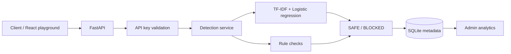

# PromptGuard

**ML-assisted prompt security gateway and monitoring dashboard · portfolio edition**

[](https://github.com/nisa3131/PromptGuard/actions/workflows/backend.yml)
[](https://github.com/nisa3131/PromptGuard/actions/workflows/frontend.yml)

## Overview

PromptGuard evaluates untrusted text before it reaches an AI application. It combines a TF-IDF/logistic-regression baseline with explicit security rules, API key authentication and operational analytics. It is a demonstrable security prototype, not a guarantee that every attack will be detected.

## Capabilities

| Module | Implementation |
|---|---|
| Detection | Binary ML classifier plus rule-based indicators |
| Decisions | SAFE / BLOCKED, threat indicator, latency and decision source |
| Access | Admin key, scoped integration keys, revocation |
| Monitoring | Request counts, blocked ratio, threat distribution, recent events |
| Privacy | Prompt hashes instead of plaintext logs |
| Delivery | FastAPI, SQLite, React/TypeScript, Recharts, Docker and CI |

## Architecture



## Repository layout

```text
ml/train.py        Dataset loading, training and evaluation
ml/models/         Locally generated trusted model artifact
backend/app/       Detection, API, authentication and persistence
backend/tests/     Health, API key lifecycle and detection tests
frontend/src/      Playground, key management and analytics
docs/              Architecture and demo guide
.github/workflows/ Continuous integration
docker-compose.yml Local deployment
```

## Quick start (Windows)

Install Git and Docker Desktop. Open PowerShell:

```powershell
git clone https://github.com/nisa3131/PromptGuard.git
cd PromptGuard
docker run --rm -v "${PWD}:/project" -w /project python:3.12-slim sh -c "pip install -r ml/requirements.txt && python ml/train.py"
$key = [guid]::NewGuid().ToString("N") + [guid]::NewGuid().ToString("N")
if (!(Test-Path .env)) { "PROMPTGUARD_API_KEY=$key" | Set-Content -Encoding ascii .env }
docker compose up --build -d
```

Dashboard: http://localhost:3001 · API docs: http://localhost:8001/docs

Copy the configured admin key privately into the dashboard:

```powershell
((Get-Content .env | Where-Object { $_ -like 'PROMPTGUARD_API_KEY=*' }) -replace '^PROMPTGUARD_API_KEY=','') | Set-Clipboard
```

## API reference

| Method | Endpoint | Access |
|---|---|---|
| GET | /api/v1/health | Public |
| POST | /api/v1/analyze | Valid API key |
| GET | /api/v1/analytics | Admin |
| GET, POST | /api/v1/api-keys | Admin |
| DELETE | /api/v1/api-keys/{key_id} | Admin |

Example request:

```bash
curl -X POST http://localhost:8001/api/v1/analyze \
  -H "X-API-Key: YOUR_LOCAL_KEY" \
  -H "Content-Type: application/json" \
  -d '{"prompt":"Explain machine learning."}'
```

## ML methodology

The training script uses the supplied train/test splits of [deepset/prompt-injections](https://huggingface.co/datasets/deepset/prompt-injections). It fits TF-IDF and logistic regression on training data, reports classification metrics and confusion matrix on the held-out split, then saves the full fitted pipeline. Numerical performance is not claimed without a verified evaluation report. The runtime's default threshold is 0.7; the baseline classification report uses the classifier default decision rule, so these results are not equivalent to deployed hybrid performance.

## Security and configuration

Set PROMPTGUARD_API_KEY as a secret. Integration keys are hashed and revocable; admin analytics require the admin key. Missing models fail closed. Rule decisions do not claim calibrated confidence. Prompt hashes are not anonymization. Only load trusted joblib artifacts.

## Testing and deployment

Backend integration tests verify authorization, key lifecycle and representative detector decisions with mocked model behavior; frontend CI verifies the build. See [free cloud demo instructions](docs/FREE_DEPLOYMENT.md) for the single-container demo. Free hosting has temporary storage and resource limits.

## Limitations

Binary classification and heuristic threat labels do not establish robust protection against novel attacks. Independent adversarial evaluation, calibration, rate limiting, persistent storage and production security review remain necessary.

## Interview resources

[Architecture and demo walkthrough](docs/INTERVIEW_GUIDE.md)
